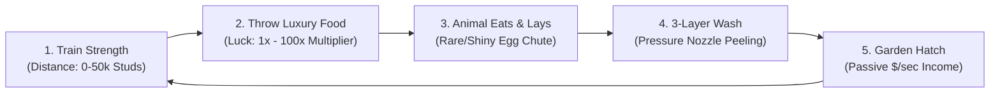

# EGG SANCTUARY: FEED, CLEAN & HATCH
## Master Game Design Document (GDD v2.1 — "Food Luck & Dual Treadmill" Edition)
*Roblox Mobile-First Production Specification*

---

> [!IMPORTANT]
> **Production Document Notice:**  
> The Game Design Document has been updated to **Version 2.1 (Food Luck & Dual Treadmill Edition)** and re-compiled into a publication PDF:  
> **[Egg_Sanctuary_Clean_and_Hatch_GDD.pdf](file:///C:/Users/USER/.gemini/antigravity/scratch/EggSanctuary/Egg_Sanctuary_Clean_and_Hatch_GDD.pdf)**  
> *(Local project path: `C:\Users\USER\.gemini\antigravity\scratch\EggSanctuary\Egg_Sanctuary_Clean_and_Hatch_GDD.pdf`)*

---

## 1. Document Control & Metadata

| Field | Detail |
| :--- | :--- |
| **Project Codename** | Project Feed & Scrubber (Egg Sanctuary) |
| **Document Version** | v2.1 (Food Luck & Dual Treadmill Architecture) |
| **Target Platform** | Roblox (Mobile-First 75%, PC 15%, Console 10%) |
| **Genre** | Distance Thrower / Restoration / Tycoon Hybrid |
| **Target Audience** | Ages 6–24 (All-Ages, Casual & Midcore) |
| **Dual Treadmill** | **Strength = Distance** | **Food Tier = Luck & Rarity** |
| **Tech Stack** | Luau, Rojo 7.x, ProfileService, ReplicatedStorage |
| **Benchmark Target** | 250,000 – 400,000+ Concurrent Players (CCU) |

---

## 2. Executive Summary

**Egg Sanctuary: Feed, Clean & Hatch** is an innovative, high-dopamine hybrid Roblox title engineered to capture the massive 400,000+ CCU audience demonstrated by recent breakout hits like *Throw Food for Animals*, elevated with the hypnotic visual ASMR of *PowerWash Simulator* and the passive tycoon satisfaction of *Grow a Garden*.

### The Dual-Progression Treadmill
* **Strength (Gym) = DISTANCE:** Determines how far down the canyon your food flies, unlocking deeper biomes (Meadow $\rightarrow$ Swamp $\rightarrow$ Volcano $\rightarrow$ Reef $\rightarrow$ Galaxy).
* **Food Tier (Kitchen) = LUCK & QUALITY:** Determines the rarity multiplier, shiny mutation odds, and Alpha Boss summon rates of the egg that drops. Upgraded food ensures that throwing in early zones can yield 1-in-10,000 Shiny Mythic pets!

---

## 3. The Food Luck & Mutation Engine

When an animal catches food, the egg's rarity roll is calculated using the equipped **Food Luck Multiplier**:
$$\text{Final Egg Luck} = \text{Food Tier Luck} \times (1 + \text{Rebirth Bonus}) \times \text{VIP Multiplier}$$

### Master Food Tier & Luck Table

| Tier | Food Item | Luck Multiplier | Shiny / Mutation Chance | Special Effect / Alpha Lure |
|:---:|:---|:---:|:---:|:---|
| **T1** | **Red Apple** | **1.0x** (Base) | 0.1% (1 in 1,000) | Basic Meadow creatures only. |
| **T2** | **Carrot Cupcake** | **1.5x** Luck | 0.5% (1 in 200) | +10% chance for a **Giant Egg** (2x cash yield). |
| **T3** | **Honey Glazed Ribs** | **2.5x** Luck | 1.5% (1 in 66) | Guarantees at least an Uncommon egg drop. |
| **T4** | **Golden Star-Berry** | **5.0x** Luck | 3.5% (1 in 28) | **Guarantees at least a Rare egg drop.** |
| **T5** | **Flame-Grilled Steak**| **10.0x** Luck | 7.5% (1 in 13) | Lures Magma Drakes out of volcanic craters. |
| **T6** | **Rainbow Cotton Candy**| **25.0x** Luck | 15.0% (1 in 6.6) | Can trigger a **Rainbow Pet Mutation (5x income)**! |
| **T7** | **Abyssal Caviar** | **50.0x** Luck | 22.5% (1 in 4.4) | Attracts Deepsea Krakens and Pearl Leviathans. |
| **T8** | **Cosmic Ambrosia** | **100.0x Luck** | **35.0%** (1 in 2.8) | **1 in 50 chance to summon the Godly Galaxy Titan!** |

---

## 4. Content Matrix: Distance Track & Biomes

| Zone & Distance | Recommended Food | Featured Beasts | Laid Egg Type | Base Yield |
| :--- | :--- | :--- | :--- | :---: |
| **1. Dewdrop Meadow** (0 – 300 Studs) | Apple, Cupcake *(T1–T2)* | Fluffy Bunny, Moss Turtle, Hamster | Muddy Meadow Egg *(Common/Uncommon)* | 1 – 5 $/s |
| **2. Toxic Slime Marsh** (300 – 1,500 Studs) | Honey Ribs, Star-Berry *(T3–T4)* | Slime Frog, Bog Lizard, Venom Croc | Slime-Coated Egg *(Rare/Epic)* | 15 – 60 $/s |
| **3. Cinder Volcano** (1,500 – 5,000 Studs) | Flame Steak *(T5)* | Ember Hound, Magma Wyrm, Phoenix | Obsidian Magma Egg *(Epic/Legendary)* | 200 – 800 $/s |
| **4. Sunken Coral Reef** (5,000 – 15,000 Studs) | Rainbow Candy, Caviar *(T6–T7)* | Coral Dragon, Deepsea Kraken, Whale | Barnacle Pearl Egg *(Legendary/Mythic)* | 2.5k – 10k $/s |
| **5. Celestial Galaxy** (15,000 – 50,000+ Studs) | Cosmic Ambrosia *(T8)* | Nebula Kirin, Solar Drake, Galaxy Titan | Starlight Crystal Egg *(Mythic / Godly 1 in 10k)* | 50,000+ $/s |

---

## 5. Monetization Strategy

| Product | Type | Price (R\$) | Strategic Purpose |
| :--- | :--- | :---: | :--- |
| **Auto-Thrower Drone** | Gamepass | R\$ 799 | Automatically throws food every 5s while you wash eggs or AFK train! *(Top Seller)* |
| **Auto-Washer Robot** | Gamepass | R\$ 899 | Cleans laid eggs instantly, letting players focus purely on throwing and upgrading. |
| **Lucky Chef Pass** | Gamepass | R\$ 499 | Permanently doubles (+100%) the Luck Multiplier of all equipped foods. |
| **+4 Garden Incubators** | Gamepass | R\$ 399 | Expands simultaneous egg hatching capacity from 4 to 8. |
| **Golden Feast Bait** | Dev Product | R\$ 99 | Guarantees the animal lays a **Golden Mutated Egg** (3x cash yield). |
| **Instant Hatch Potion** | Dev Product | R\$ 49 | Instantly hatches any incubating egg. |

---

## 6. Direct File Links

* **Updated Master PDF:** [Egg_Sanctuary_Clean_and_Hatch_GDD.pdf](file:///C:/Users/USER/.gemini/antigravity/scratch/EggSanctuary/Egg_Sanctuary_Clean_and_Hatch_GDD.pdf)
* **HTML Specification:** [Egg_Sanctuary_Clean_and_Hatch_GDD.html](file:///C:/Users/USER/.gemini/antigravity/scratch/EggSanctuary/Egg_Sanctuary_Clean_and_Hatch_GDD.html)
* **Artifact PDF Mirror:** [Egg_Sanctuary_Clean_and_Hatch_GDD.pdf](file:///C:/Users/USER/.gemini/antigravity/brain/27b361aa-9075-45ad-b1bd-ebf27a9169a0/Egg_Sanctuary_Clean_and_Hatch_GDD.pdf)
