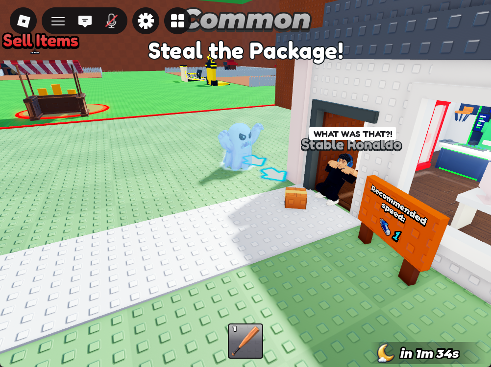
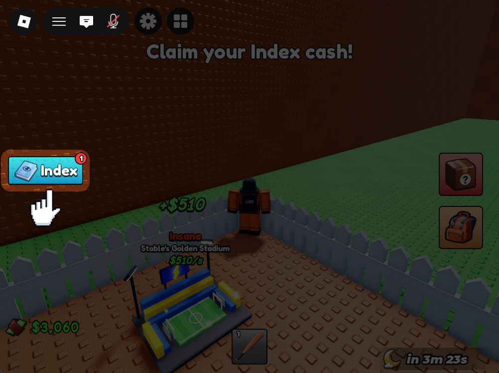
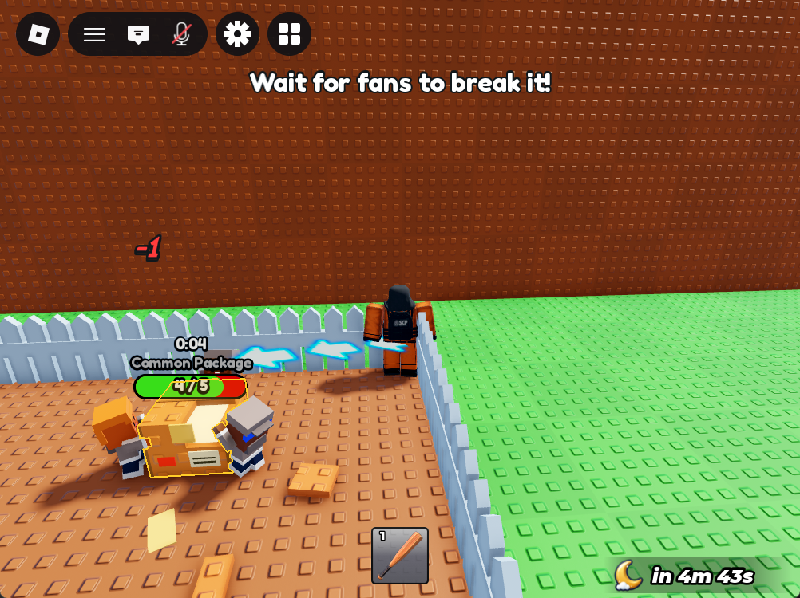
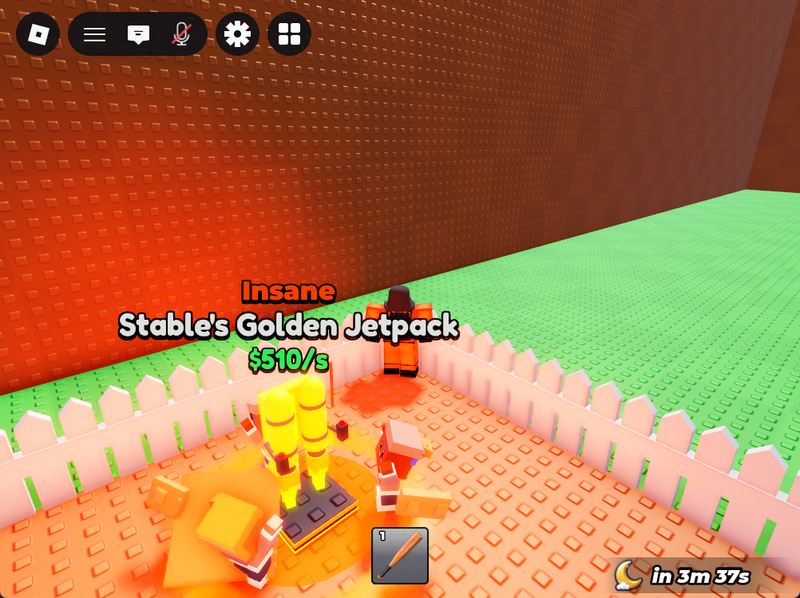
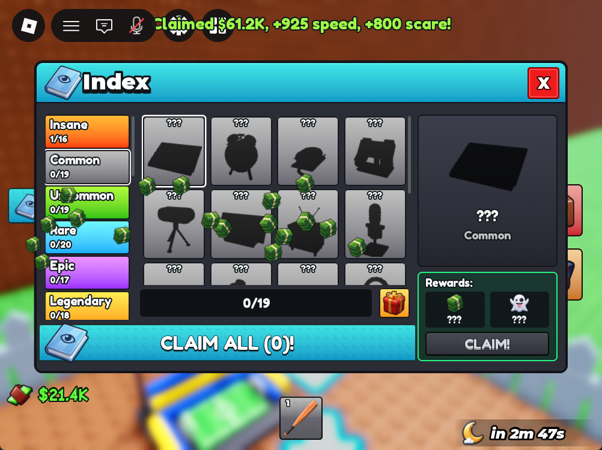
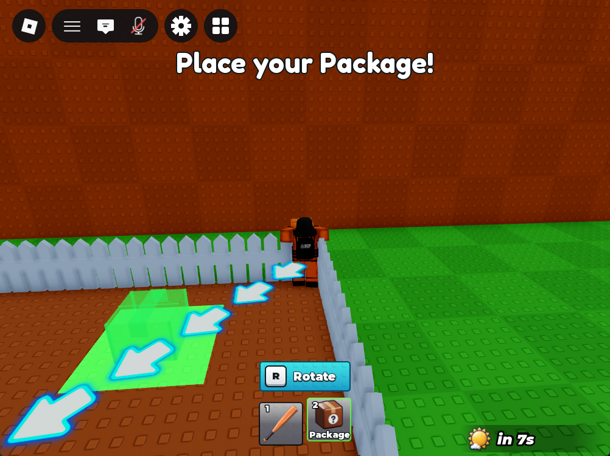
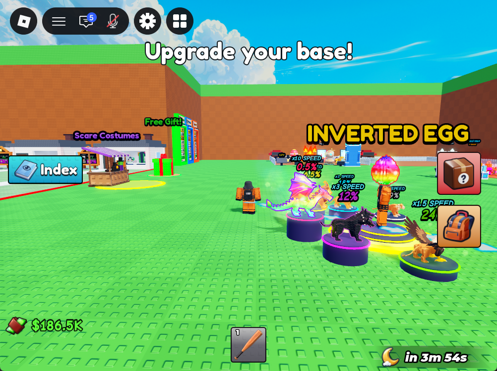
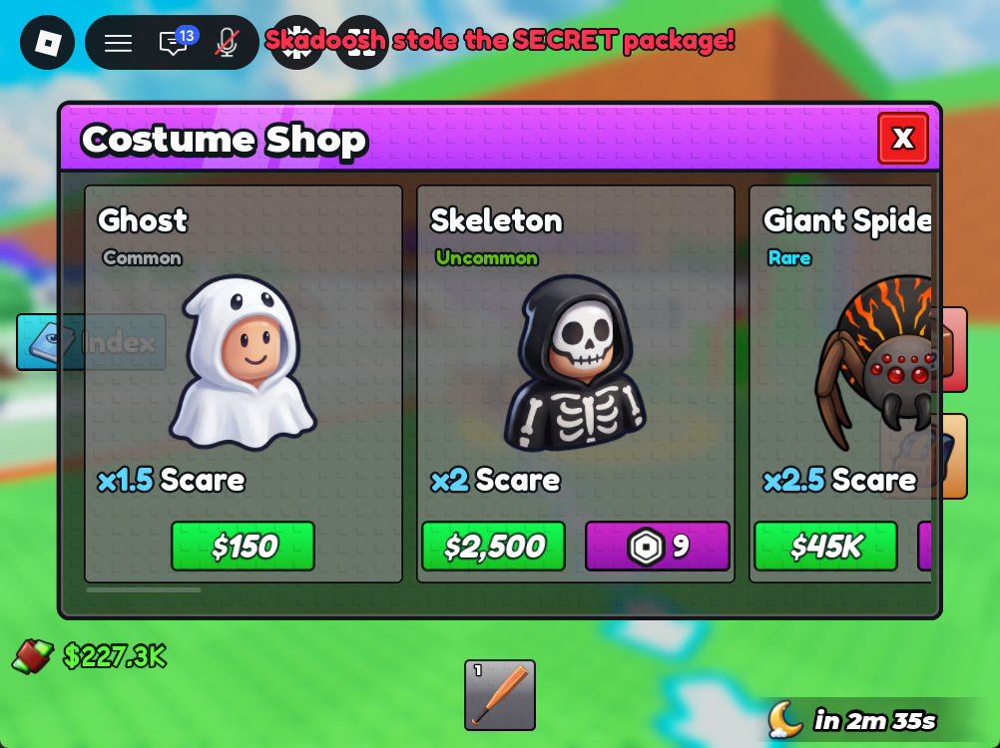

# Game study: "Scare Your Favorite Streamer" (Bacon 1M CCU)

Research for the "Feed and Lay" redesign. Played live on 2026-11-19 with the `roblox-play` tool, about 95 actions (~17 minutes), fresh account state, Windows player at 1002x750. No Robux spent, no chat used. Sounds were not capturable, so audio is not covered.

Screenshots referenced below are in `shots/scare-streamer/`.

---

## 1. One-paragraph summary

It is a "steal-a-brainrot"-style tycoon reskinned around streamers. You walk down a street of houses, knock on a streamer's door, scare them when they open it, grab the mystery **package** they drop, run it back to your fenced **base**, place it, let your NPC **fans** smash it open, then press E to roll a random **item** that earns cash per second forever. Cash buys base upgrades (more fans, faster breaking), scare costumes (stronger scares) and speed. A 5-minute **day/night cycle** resets all packages and announces rare spawns server-wide, and other players can steal from you. The whole thing is played without reading a single menu: one line of text at the top of the screen plus glowing arrows on the floor tell you the next step at every moment.

---

## 2. Core loop (observed twice end to end)

| Step | What you do | What the game shows | Time |
|---|---|---|---|
| 1 | Walk to a house (follow floor arrows) | `E Knock` prompt over the door, house sign shows tier ("Common House") | 5-10 s |
| 2 | Press E (knock) | Streamer NPC walks out, door opens | ~2 s |
| 3 | Press E (scare) | Ghost/costume pops up in the streamer's face, streamer flinches, package drops | ~1 s |
| 4 | Hold E on the package | It goes into hotbar slot 2, banner switches to **"RUN!"** then **"Go to your base!"** | ~1.5 s |
| 5 | Run back on the arrow trail | Arrow trail re-routes to your plot | 10-20 s |
| 6 | Click the floor to place | Green translucent ghost box snaps to the grid, `R Rotate` chip appears above the hotbar | ~2 s |
| 7 | Wait | Fans run in and punch the box; HP bar `5/5 → 0`, red `-1` damage numbers, a `0:05` countdown, cardboard chunks fly | ~5 s |
| 8 | Press E "Open" | Slot-machine roll of item names over the box, colour-coded rarity ("Insane") and `$510/s` | ~2-3 s |
| 9 | Passive | Item sits on your plot, `+$510` floats up every second, cash counter climbs | forever |
| 10 | Spend | Upgrade fans, buy costume, claim Index cash | — |

Loop 1 (first package) took about 2 minutes because I was learning the camera; loop 2 took about 1 minute. A practised player probably does it in 30-40 s.

**The reward has three layers:** the instant reveal (gambling thrill), a permanent income line (`$/s` that never stops), and a collection tick in the Index (completion urge). One action pays out on all three.

---

## 3. First five minutes / onboarding

- **No tutorial screen at all.** The tutorial *is* the objective banner plus the floor arrows. The banner text changes on every state transition: "Knock on a streamer's door" → "Scare the streamer" → "Steal the package" → "RUN!" → "Go to your base!" → "Place your Package!" → "Wait for fans to break it!" → "Open the Package!" → "Claim your Index cash!" → "Upgrade your base!".
- **HUD is revealed progressively.** At spawn the custom HUD was only the hotbar (bat) and the day/night timer. The cash counter, Index button, Packages button and Items button only **appeared after the first package was opened** (shot 11), and the Shop button only appeared after the first costume purchase. A brand new player never sees an unexplained button.
- **Pointing-hand cursor + red notification dot** on the new Index button, with a pulsing border, tells you exactly what to click next (shot 11).
- Things you cannot use yet are **gated with a reason**: walking into the egg ring said "Complete the tutorial first!"; the Items panel showed a red "Unlock Trainers First" bar.
- **Time to first reward: ~2 minutes** (first item, $510/s). Time to first *big* reward: about 2.5 minutes — claiming the Index entry paid **$61.2K + 925 speed + 800 scare** in one burst, which immediately let me buy the fan upgrade ($15K) and a costume ($45K). The game front-loads money so the first shop visit feels rich.
- I had over $200K within ~10 minutes, purely from one passive item plus the Index claim.

---

## 4. HUD layout and visual craft

Measured on a 1002x750 window (percentages are of window width/height).

| Element | Position | Size | Treatment |
|---|---|---|---|
| Objective banner | Top centre, y≈105 (14% down), sits just under Roblox's top bar | Text cap height ~35 px (~5% of height) | White, heavy rounded font (Fredoka One / "Bubble" style), thick dark stroke (~3 px) and soft drop shadow. No background panel. |
| Event/toast line | Top centre, y≈40, overlays the Roblox top bar | ~25 px | Coloured by meaning: green for gains ("Claimed $61.2K, +925 speed, +800 scare!"), red for threats ("Skadoosh stole the SECRET package!"). Rarity names in rarity colour inside white text. |
| Cash counter | Bottom-left, x 15-160, y≈657 | ~25 px text, ~40 px icon | Bright green numbers with dark stroke, cash-stack icon on the left, a small green "+" badge (buy more cash) appears after the shop unlocks. Abbreviates (K, M, B). |
| Left menu buttons (Index, Shop) | Left edge, x 15-165, y 315-445 | ~150x55 px each (~15% width) | Solid saturated pill (cyan for Index, green for Shop), 3D cartoon icon overhanging the left edge, white bold label with stroke, dark outline, slight bottom bevel. |
| Right menu buttons (Packages, Items) | Right edge, x 880-970, y 308-500 | ~88x88 px squares | Square tiles, red (Packages box icon with "?") and orange (backpack icon), same dark outline. Icon only, no label. |
| Hotbar | Bottom centre | ~70x70 px slots | Grey slots with digit in corner; the package slot is labelled "Package". |
| Day/night timer | Bottom-right, x 770-990, y≈722 | ~25 px text + 35 px icon | Moon (night next) or sun icon, italic white "in 4m 46s", on a dark translucent gradient strip. Turns **red** below ~10 s. |
| Context prompt | Over the target object | ~170x50 px | Dark rounded card, white key cap "E" on the left, small grey context label ("Common House") over a bold verb ("Knock", "Open"). |

**Panels** (Index, Packages, Items, Costume Shop, Shop) share one template: dark charcoal body with a ~4 px near-black outline and rounded corners, a coloured title bar (cyan, red, blue, purple, lime — each menu has its own colour, matching its HUD button), big white title with stroke at top-left, and a **red square "X"** close button top-right. They open centred and blur the 3D world behind them. Opening a panel with a timer running keeps the HUD timer and cash visible.

**Colour language** is consistent everywhere: green = money / buy with cash / positive; purple tile with Robux icon = premium; red = danger, unaffordable price, close; rarity colours (grey Common, green Uncommon, blue Rare, purple Epic, gold Legendary, orange-red Insane, plus Omega, Immortal, Ultimate, Secret, Godly, Celestial). **Affordability is shown by colour alone**: the fan upgrade price was green ($15K, affordable) and turned red ($400K) the moment it became unaffordable.

**Icon style:** chunky 3D-rendered cartoon icons (cash stacks, gift box, backpack, book with an eye, ghosts with tongues out), always slightly overhanging their button, always with a soft glow/sunburst behind them in shop tiles.

**World labels:** BillboardGuis everywhere: house tier signs, "Free Gift!" in green, "Scare Costumes" in purple, "INVERTED EGG" in big yellow, pet odds over each pedestal ("x10 SPEED 0.5%"), item name + rarity + `$/s` over each placed item, other players' base names, and rare package names visible across the map ("SECRET Rakai's Package").

---

## 5. Motion and feedback

What I could see in stills (timings estimated from consecutive screenshots ~1-2 s apart):

- **Scare:** the costume (ghost) is shown huge in the streamer's face, the NPC flinches; about 1 s. Instant cause-and-effect for one key press.
- **Placement preview:** bright green translucent box plus a green grid footprint follows the mouse; snaps to grid. Valid = green.
- **Fans breaking:** 2-3 NPC fans run over and punch the box; each hit spawns a **red "-1" pop-up number** that floats up and fades (~0.5 s), the HP bar drains green→red, cardboard chunks fly off, and a **countdown "0:05"** sits above. You watch your reward being "earned" by your own minions.
- **Reveal:** the item name and model **cycle like a slot machine** (Golden Jetpack → Golden Rover → Golden Stadium) for ~2-3 s with a burst of orange/gold light and particles on the floor, then lands. The rarity word sits above in its colour.
- **Income tick:** `+$510` in green italic floats up from the item once per second; the bottom-left cash number rolls up.
- **Index claim:** clicking "CLAIM ALL" fires **~20 cash-stack icons that spray from the button and fly to the cash counter** (~1 s), the counter jumps ($21K → $84K in about a second, so it rolls rather than snapping), and a green toast summarises the payout. The claim button greys to "CLAIM ALL (0)!".
- **Upgrade:** green floating text "Fans upgraded to level 2!" over the world, the rate label over the building changes ("1/s" → "2/s"), the price button flips from green to red.
- **New button:** red badge with count, pulsing outline and an animated pointing-hand cursor.
- **Night transition:** a full-screen white flash with a giant moon icon and "3s" countdown, then the sky changes; "ALL PACKAGES RESET!" plus announcements of rare spawns ("A **Celestial** Package spawned at Kai Cenat's house") in three lines at top centre.
- **Purchase:** costume buy instantly swaps "$45K" for "Unequip", other owned costumes show "Equip", a green toast states the effect ("Giant Spider! x2.5 Scare at the trainer.").

---

## 6. How the world guides the player

1. **Glowing arrow trail on the ground.** White chevrons with a cyan neon outline, about 1 stud apart, getting larger near the camera. It always runs from your feet to the next objective and re-routes the instant the objective changes (house → base → upgrade sign → shop stall). This is the single strongest onboarding device in the game; I never got lost after the first minute.
2. **One-line objective banner** at top centre, imperative and short ("Place your Package!").
3. **Proximity prompts** with a verb ("Knock", "Open").
4. **Glowing floor rings** (yellow) mark interactive stalls: step in and the shop opens. No button press needed.
5. **Colour-coded billboards** over every point of interest, readable from across the map.
6. **A red line** on the ground marks the boundary of the street/safe areas.
7. **Server-wide text announcements** pull you toward rare loot ("Secret Package spawned at Rakai's house") and the rare package's name floats in the sky over that house.

---

## 7. Progression systems seen

- **Currencies:** Cash ($, main), Speed (walk speed stat), Scare (scare power stat). Robux as premium.
- **Items** (from packages): rarity tiers from Common up to Celestial (13 tiers seen in the Index), each with a fixed `$/s`. "Items 1/7 Active": you have 7 display slots, "Equip Best" button auto-fills them.
- **Index (collection book):** per-rarity tabs with counts (Insane 1/16, Common 0/19, Rare 0/20 …), silhouettes of undiscovered items with "???", a per-item reward (cash + scare) and a per-page gift box. Each new discovery = a claimable cash burst. ~200 items in total.
- **Base upgrades:** "Fans" building, Level 1→2 cost $15K, Level 2→3 cost $400K (roughly x25). Breaking rate 1/s → 2/s. Each level also offered a Robux price (9, 16) next to the cash price.
- **Costumes:** scare multiplier x1.5 ($150) → x2 ($2.5K) → x2.5 ($45K) → … Witch x3.5 ($75M) → Kraken x4 ($2.8B) → Devil x5 (Mythic). Steep exponential curve; each costume also sold for Robux (9 → 80).
- **Speed Auras** stall and **treadmill trainers** ("Unlock the trainers first!"): a second stat grind behind a gate.
- **Inverted Egg:** a pet egg with odds printed over each pet on a pedestal (x1.25 speed 39%, x1.5 24%, x2 18%, x3 12%, x5 6.5%, x10 0.5%). Pets are pure stat multipliers. Gated behind finishing the tutorial.
- **House tiers:** "Common House" signs with % and stats; higher-tier streamer houses further down the street hold better packages.

---

## 8. Timers and what they are for

- **Day/night cycle, ~5 min:** always on screen bottom-right. At each switch all packages reset and rare ones (Secret, Celestial) spawn at named houses with a server-wide announcement. Purpose: a constant "next drop in X" appointment that keeps you in the session and makes everyone rush the same house (PvP moment).
- **Package break timer, ~5 s:** short enough to watch, long enough to build anticipation; doubled by a paid pass.
- **Free Gift:** a big green present labelled "Free Gift!" next to the shop; it appeared to be a timed/playtime gift (I did not manage to trigger it in the time available).
- No daily login streak, no codes box, no quest list was found in what I reached.

---

## 9. Monetisation (looked, never bought)

- **Shop button** (appears after first costume): passes (x2 Break 280 R$, x2 Money 120 R$), "DOUBLE Your SPEED", trainer upgrade, Speed packs (+150K / +1M / +10M), Scare packs (+750K for 40 R$ up to +10B), Cash packs ($306K for 32 R$ up to $100M for 480 R$).
- **Dual pricing on every upgrade:** each costume and base upgrade shows a green cash button **right next to** a purple Robux button. The cheapest Robux option is always tiny (9 R$), the classic "it's only 9" anchor.
- **Small "+" badge on the cash counter** routes to cash packs.
- No forced Robux pop-ups appeared during play. Monetisation is ambient, never blocking.

---

## 10. Social and retention hooks

- **Stealing (PvP):** other players' bases are open; the toast "Skadoosh stole the SECRET package!" proves your loot is at risk. Loss aversion keeps you near your base and coming back.
- **Server-wide announcements** of rare spawns and steals create shared moments.
- **Visible other bases** full of glowing high-rarity items show you what's possible.
- **Streamer theme:** real creator names (Kai Cenat etc.) on houses: recognition and curiosity.
- **Collection book** with ~200 silhouettes: the completionist pull.
- **Offline-feeling passive income:** money keeps rolling while you browse menus.

---

## 11. Psychological hooks, why they work, and are they fair to copy

| Hook | Why it works | Fair for Feed and Lay? |
|---|---|---|
| Always-visible next step (banner + arrows) | Removes every "what now?" moment; zero reading of tutorials | Yes, copy fully |
| Variable reward reveal (slot-machine roll) | Unpredictable reward spikes dopamine more than fixed ones | Yes for in-game currency eggs; keep odds visible |
| Anticipation phase (5 s break, HP bar, damage numbers) | Waiting for a reward you can *see coming* is itself pleasurable | Yes, perfect for eggs hatching |
| Effort justification (you scared, stole, ran) | Rewards you worked for feel bigger | Yes: feed → lay → collect is the same arc |
| Permanent income from every pull | Every action leaves a lasting trace; no "wasted" roll | Yes: hens/pets that keep producing |
| Collection book with silhouettes | Zeigarnik effect: incomplete sets nag | Yes, very strong fit for pets/eggs |
| Front-loaded windfall (Index claim $61K) | Early generosity creates a "this game is rich" impression and a first shopping spree | Yes |
| Progressive HUD reveal | Low cognitive load; each new button feels like a reward | Yes |
| Recurring timed event (day/night drops) | Appointment mechanic, keeps sessions long | Yes, as a "golden hour" or "rare egg rain" |
| Steal / loss aversion | Fear of losing is stronger than joy of winning | Only lightly (e.g. raccoons nibbling eggs) — a younger audience punishes harsh loss |
| Robux button right next to cash price, tiny 9 R$ anchor | Price anchoring and convenience | Use with care; keep it optional and never block progress |
| Exponential costs (x25 per level) | Constant goal just out of reach | Yes, but tune so the next goal is always reachable in a few minutes |

---

## 12. What worked, what was confusing, what I could not reach

**Worked:** zero-friction onboarding; consistent colour language; every panel one click from closing; rewards stacked on one action; world constantly in motion (fans, floating numbers).

**Confusing:**
- Third-person camera hides the arrow trail behind the character when walking toward the camera; I overshot the base twice.
- The package placement needs a mouse click on the floor; nothing tells keyboard-only players that.
- Opening a package needed me to stand very close; the prompt range is small.
- The chat window opened over the Index panel when I first clicked it (Roblox chat, not the game's fault, but the game's panel sits under it).
- Robux and cash buttons look equally prominent; a child could easily mis-click the purple one (the Roblox purchase dialog would still guard it).

**Not reached in ~17 minutes:** the Inverted Egg (gated by tutorial completion), trainers/treadmills, Speed Auras purchase, stealing from or being robbed by a real player, the Free Gift claim, rebirth (if any), group/likes rewards, codes (no codes UI found), daily rewards (none found), the settings and inventory menus beyond a glance (the settings gear opened Roblox-style toggles; the grid button opened a simple inventory).

---

## 13. What Feed and Lay should steal (ranked)

1. **Floor arrow trail + one-line objective banner.** Draw a glowing chevron path from the player to the next goal (feeder, nest, shop) and show a single imperative line at top centre that changes on every state change.
2. **Watchable anticipation before every reward.** When an egg is laid, give it a visible 3-5 s "crack" phase with a progress bar, wobble and small floating numbers before the hatch.
3. **Slot-machine hatch reveal with rarity colour.** Cycle 3-5 pet names/models for ~2 s with a light burst, then land on the result with the rarity word in its colour above it.
4. **Every hatch leaves a permanent earner.** Make each pet/hen a lasting `+X/s` producer that floats its income above its head every second, so no hatch ever feels wasted.
5. **Collection Index with silhouettes and claim bursts.** A per-rarity book of "???" silhouettes where each new discovery is claimable for a cash burst that flies icons into the counter.
6. **Progressive HUD.** Start with nothing but the objective and hotbar, reveal each button (with a red dot and pointing hand) only at the moment it first becomes useful.
7. **Fly-to-counter coin animation and rolling numbers.** Any gain spawns 10-20 coin icons that fly to the currency display, and the number rolls up rather than snapping.
8. **One shared panel template with per-menu colour.** Dark body, thick outline, coloured title bar matching its HUD button, red X top-right, background blur; reuse it for every menu.
9. **Affordability by colour on every price.** Green when you can afford it, red when you can't, updated live, so players read the shop in a glance.
10. **A world-wide timed event with announcements.** A ~5-minute "golden hour" timer always on screen that resets nests and spawns a rare egg somewhere, announced to the whole server.
11. **Generous early windfall.** Give one big claimable reward in the first 3 minutes so the first shop visit buys two things.
12. **Printed odds over each pet in the egg display.** Show the pet model on a pedestal with multiplier and percentage overhead, which is both honest and enticing.
