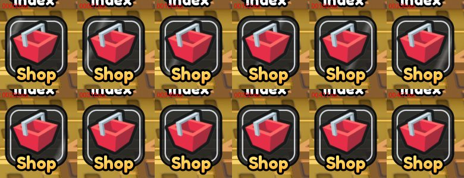

# Preset: DarkTiles (from Throw Food For Animals)

Module: `src/client/UI/Presets/DarkTiles.luau`. Study: `../ui-study-popular-games.md` section 1.
Captured 2026-11-19 at 1002x750, ~20 frames per second bursts (frame times in ms after the input). "Sampled" = read from pixels, "est." = judged by eye. Sizes: px at 1080 reference, fraction of screen height (H) in brackets.

Character in one line: **dark charcoal surfaces, saturated gradient title bars, big labelled square tiles that get out of the way.**

## Palette

| Role | Hex | Source |
|---|---|---|
| Panel body | `#242222` | sampled |
| Inset / section pill | `#1E2130` | est. |
| Divider lines | `#313B54` | sampled |
| Outline, text stroke | `#000000` | sampled |
| HUD tile face / inner rim | `#29282D` / `#888A8F` | sampled |
| Panel title text | `#FFF8E0` cream-white | est. |
| Tile label on hover | `#FFD24A` | est. |
| Cash number | `#D4FF3A` | est. |
| Power number | `#2EB8FF` | est. |
| Buy button | `#B7FF59` → `#29DE00` (top → bottom) | sampled |
| Big action button (Equip Best) | `#FCB51D` → `#F18F0C` | sampled |
| Close button | `#FF6E71` → `#DB1225` | sampled |
| Slider fill | `#0098FE` | sampled |
| Toggle on | `#79FF12` | sampled |
| Locked button | `#474953` | sampled |
| Rarity tiles (highlight sampled; base est.) | Common `#E5E5EA`/`#C9C9D1`, Uncommon `#B0FA89`/`#6EDB3A`, Rare `#94CDFF`/`#3D8BFF`, Epic `#DEA0FE`/`#B04CF0` | |

Gradients: shop title bar horizontal `#FF9100 → #FFD220 → #FF9100` with two translucent white diagonal streaks on the right third; collection title bar vertical `#F446E5 → #A03EC6`; settings title bar silver `#E8EAEE → #9097A3` (est.); all buttons vertical light-to-dark with one white diagonal gloss streak at ~0.2 transparency.

## Shape and type

- **Fonts:** heavy rounded display face for everything (Fredoka One is the closest Roblox font); body in Builder Sans Bold.
- **Type (1080 ref):** reveal name 86 (0.080 H), big button 63 (0.059), objective 43 (0.040), panel title 40 (0.037), price 38 (0.035), tile label 36 (0.033), stats 32 (0.030), card names 28, small 17 (0.016).
- **Stroke:** text 4 px black on every HUD and button label; panels 4 px black; tiles 3 px black plus a 2-3 px grey inner rim.
- **Radius:** tiles 20, panels 14, buttons 12, close 9, pills fully round.
- **Depth:** no separate base strip; the vertical gradient and a black outline do the work.

## HUD map

| Where | What | Size |
|---|---|---|
| Left edge, from y 0.38 H | Collection tile, Shop tile (stacked) | 0.13 H squares, 0.027 H gap |
| Right edge, centre y 0.52 H | Pets tile | 0.13 H |
| Bottom-left | Power and Cash rows: icon 0.04 H + number 0.03 H, no backing | |
| Top centre, y 0.15 H | Objective line, no backing | 0.040 H text |
| Bottom centre | Hotbar slot 0.08 H with rate on top, tag bottom-right | |
| Top bar | Settings gear added after Roblox's own buttons | |

## Component recipes

- **HUD tile:** square, face `tile`, 3 px black outline + 2 px grey inner rim, radius 20; a 3D icon fills the top 70 %; label centred on the bottom edge (half outside), white with 4 px stroke. Hover: label turns gold and a diagonal shine sweeps once. 
- **Panel:** body `panel`, 4 px black outline, radius 14; title bar 0.067 H tall with a gradient per menu, title left-aligned; close square 0.056 H inset at the right of the bar; optional secondary button left of the close (gift). Centred panels blur the world and push the HUD tiles off-screen.
- **Drawer:** same shell docked to the right edge (0.35 W x 0.77 H), no blur, count chip in the title bar, big action button pinned at the bottom.
- **Section label:** dark round pill with the label, thin `divider` line either side.
- **Rarity tile:** whole tile filled with rarity colour (light top), black silhouette + "???" when unknown, rarity word at the bottom.
- **Product card:** coloured by category, value ribbon pill on the top edge, amount in a dark translucent pill, price button underneath.
- **Price button:** green gradient, currency glyph + number, white text with stroke.

## Motion (measured)

| Motion | From → To | Time | Easing | Overshoot / notes | Evidence |
|---|---|---|---|---|---|
| Panel open | Scale ~0.6 → 1.0 (first frame already 0.76) | 0.30 s | Back Out | Peak 1.03 at 0.26 s, settled 0.40 s | [sheet](../shots/ui-presets/throw-food/motion-panel-open.jpg) |
| HUD tiles hide (panel opens) | OffsetX 0 → -0.15 H (right column +0.15) | 0.15 s | Quad In | Gone by 0.16 s, in parallel with the panel | same sheet |
| Panel close | Scale 1.0 → 0.77, then hidden | 0.15 s | Quad In | No fade seen | [sheet](../shots/ui-presets/throw-food/motion-panel-close.jpg) |
| HUD tiles return | OffsetX -0.15 H → 0 | 0.30 s | Back Out | Overshoot ~20 % of travel (23 px), settled 0.34 s; delay ~0.05 s | same sheet |
| Drawer open | Scale 0.85 → 1.0 from right-centre anchor | 0.30 s | Back Out | Peak 1.024 at 0.16 s | [sheet](../shots/ui-presets/throw-food/motion-drawer-open.jpg) |
| Button hover | Scale 1.0 → 1.05 | ~0.10 s (est.) | Quad Out | Hover already applied in the first frame | [sheet](../shots/ui-presets/throw-food/motion-button-press.jpg) |
| Button press | 1.05 → 0.98 | 0.10 s | Quad Out | Lowest at 0.15 s | same |
| Button release | 0.98 → 1.0 | 0.15 s | Back Out | Peak 1.013 at 0.2 s, settled 0.25 s | same |
| Tile hover | Label white → `#FFD24A`; white diagonal streak sweeps left → right | ~0.25 s (est.) | Linear | No scale change | [sheet](../shots/ui-presets/throw-food/motion-tile-hover-shine.jpg) |
| Cash tick | Counts up one unit at a time, ~55 ms per unit (+5 in 0.27 s) once a second | 0.27 s | Linear | No icon pop | [sheet](../shots/ui-presets/throw-food/motion-cash-roll.jpg) |
| Floor arrows | Chevrons scroll toward the goal, one arrow gap per cycle | 0.85 s loop | Linear | Yellow translucent, constant speed | [sheet](../shots/ui-presets/throw-food/motion-floor-arrows.jpg) |
| Throw flight | Screen dims to ~30 % brightness, luck readout top centre | ~0.2 s (est.) | Quad Out | | `../shots/ui-study/throw-food/07-throw-mode.png` |
| Catch reveal | White flash fades; ring vignette; mutation word, name, rate stack; tilted "NEW!" sticker (-15°) | flash ~0.35 s (est.) | Quad Out | Only stills | `../shots/ui-study/throw-food/08-catch-reveal.png` |
| Idle HUD | none: tiles do not bob or pulse | | | 30 frames over 1.2 s, no change | |
| Cannot afford | price shown red; no shake or toast observed | | | | |
| Notification dot, toast | not seen in this game | | | | |

## Use it for

A strong, readable, no-art-needed look: works with code-drawn frames only. Weak point: dark panels hide the cream SunGraphica art we own.
