# UI study: popular pet / egg / simulator games (2026-11-19)

Research for the Feed and Lay UI restyle. Companion to `game-study-scare-your-favorite-streamer.md` (which already covers that game's HUD, motion and floor-arrow onboarding; not repeated here). The spec that turns this into build rules is `ui-style-spec.md`.

Method: played live with `roblox-play/rbx.py`, Windows player at **1002x750**, fresh accounts' state, no Robux spent, no chat. Sizes below are measured in those screenshots and given as a **fraction of screen height (H)** or width (W). Sound was not capturable. Screenshots: `shots/ui-study/<game>/`.

## 0. Games picked and why

Live counts from livecounts.nl at about 20:40 UTC on 2026-11-19.

| Game | Place id | Players then | Why picked | UI approach |
|---|---|---|---|---|
| Throw Food For Animals | 120219252362013 | 188K (#4) | Closest genre to ours: throw food past a line, catch an animal, it earns $/s. | Dark panels with gradient title bars, big square HUD tiles with labels. |
| Steal An Egg | 107778070777162 | 446K (#1) | The biggest game on Roblox right now, and an egg game. | Same "brainrot tycoon" template family as Scare Your Favorite Streamer: slim pills left, square tiles right, side drawers. |
| Pet Simulator 99! | 8737899170 | 43K (#21) | The reference pet-collecting sim; a deliberately different, light UI. | White patterned panels, title floating outside, one dock button that expands into a menu bar. |
| Adopt Me! | 920587237 | 250K (#3) | Biggest pet game for young players. | **Not reached**: see 4. |

Actions taken: Throw Food 17, Steal An Egg 14, Pet Sim 99 16 (below the 30-45 asked; every menu the HUD offered was opened, so more actions would have meant progressing, not new UI). Not present in any of the three HUDs: quests panel (PS99 has a quest card instead), daily rewards panel, codes box. Trading exists only in PS99 (dock icon) and was not opened, since the next step is sending a trade.

---

## 1. Throw Food For Animals

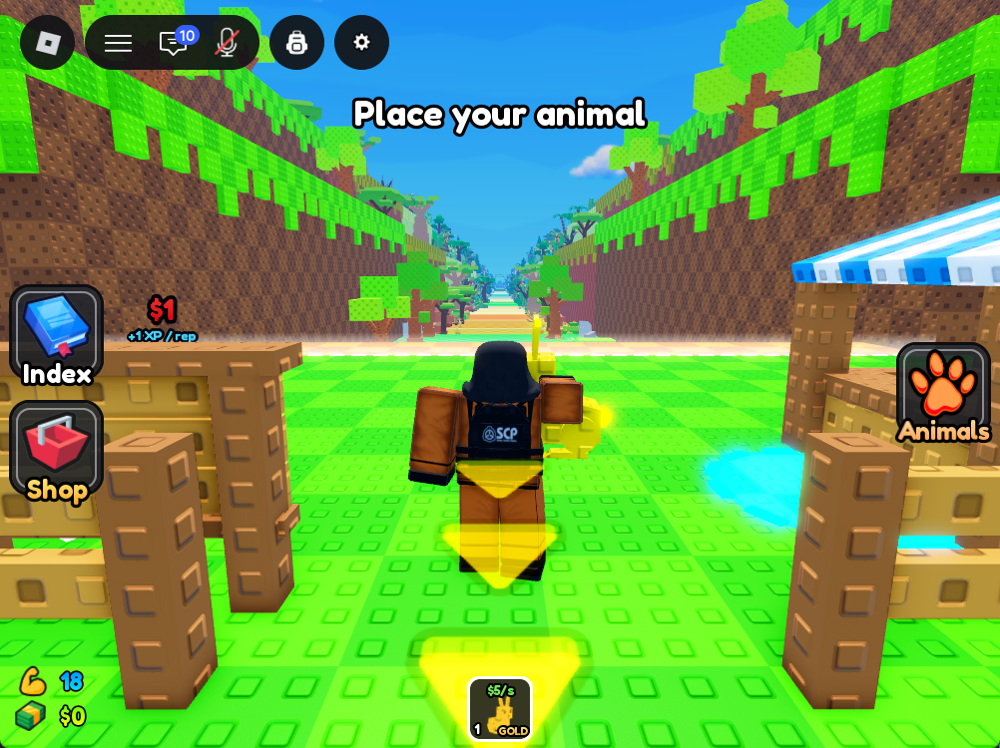

### HUD layout

| Element | Where | Size | Treatment |
|---|---|---|---|
| Menu tiles **Index**, **Shop** | Left edge, x 10-103, y 287-500, stacked, 20 px gap | 93x96 px = **0.13 H** square-ish | Charcoal rounded square (radius ~14 px), 3 px black outline, a 2 px lighter inner rim; a chunky 3D icon fills the top two-thirds; label in white heavy rounded font with ~3 px dark stroke, overlapping the bottom edge of the tile. |
| Menu tile **Animals** | Right edge, centred vertically (y 345-440) | same 0.13 H | Same tile, orange paw icon. Only one tile on the right. |
| Stats | Bottom-left, x 15, y 683 and 718 | icon ~30 px, number ~22 px (**0.03 H**) | No backing. Bicep icon + blue number (Power), cash-stack icon + green number (Cash). Dark stroke on text. |
| Objective banner | Top centre, y 115 (0.15 H) | cap height ~28 px (0.04 H) | "Place your animal": white, dark stroke, no panel. |
| Hotbar | Bottom centre | one 60x60 slot (0.08 H) | Dark translucent slot; the caught animal's icon with "$5/s" green on top, slot number bottom-left, mutation tag "GOLD" bottom-right. |
| World price | Billboard over the lift station | "$1" ~25 px | **Red** while the player has $0 (cannot afford, shown by colour alone), "+1 XP / rep" small under it. |
| Floor guidance | World | - | Yellow translucent chevrons on the floor from player to the target; a yellow ▼ marker floats over the throw line. |

### Panels

All panels: dark body (#22253A-ish), ~3 px near-black outline, radius ~10 px, **gradient title bar** ~50 px (0.067 H) with a diagonal light streak across it, title left-aligned white with dark stroke, **red square close button** (~42 px = 0.056 H, white X, dark outline) inset in the title bar's right end. The world behind is **blurred** (Roblox BlurEffect) for centred panels.

- **Shop** (centred, 62% W x 57% H, orange→yellow title bar): "Featured" section label as a dark pill between two thin divider lines; a GIFT! button (blue, gift icon overhanging) next to the X. Featured egg card: purple sunburst background, gold stroked title, a rainbow-gradient **"New!"** pill, a dark "ODDS" pill, six pet tiles each with its **% above in yellow** and its multiplier in a dark chip inside, three green buy buttons (x1, x3, x10) with a small grey "Buy x3" caption above each. Lower: product cards coloured by category (green cash, orange power, purple), each with a **value ribbon pill** on the top edge ("Good Value" blue, "Better Value" pink, "Great Value" gold, "Most Value" rainbow), amount in a dark translucent pill, price button underneath. Thin grey scroll bar inside the right edge. 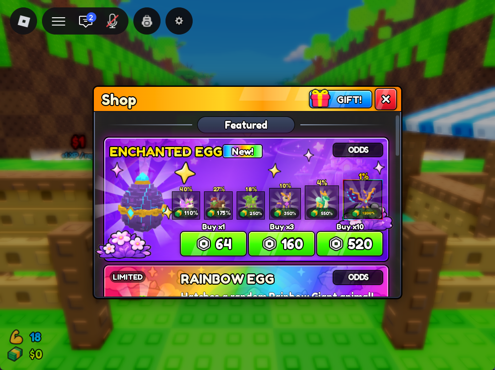 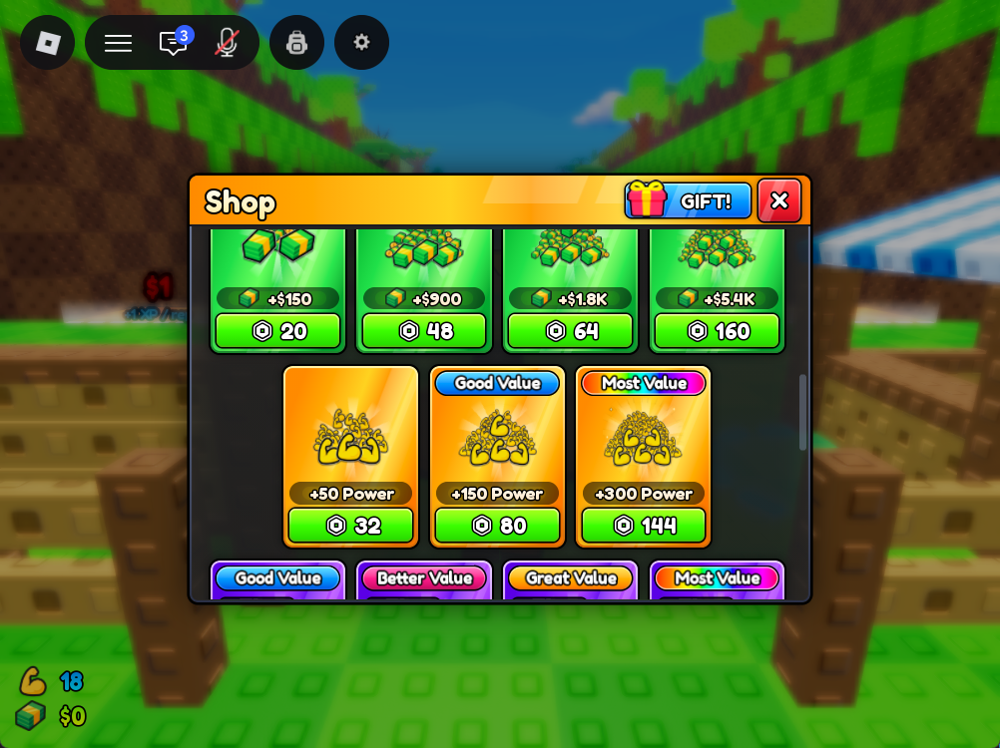
- **Purchase flow**: a Robux price button opens Roblox's own "Buy item" prompt (cancelled). No in-game confirm step before it.
- **My Animals** (docked to the right edge, 35% W x 77% H, magenta title bar, **world not blurred**): count chip "0/10" (green pill with paw icon) in the title bar, small red X. Empty state is two lines of centred white text that tell you how to fill it ("Throw food past the line to catch some."). Big **EQUIP BEST** button at the bottom, orange→yellow gradient, 4 px black outline, ~44 px text. 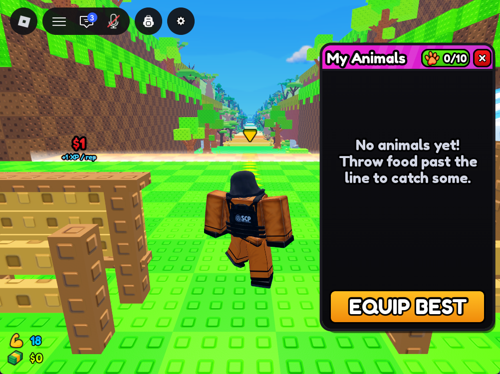
- **Animal Index** (centred, magenta title): a "World" tab pill with a globe icon under the title; a zone card on the left (cyan, picture of the zone, "(0%)"); a grid of 70 px tiles where **the whole tile is filled with the rarity colour** (grey Common, green Uncommon, blue Rare, purple Epic), the unknown animal a black silhouette, "???" on top and the rarity word at the bottom. Detail pane on the right with a bigger silhouette and the zone reward ("Leaf Trail +0.5% XP") and a grey **LOCKED** button. Footer bar "Unlocked: 0/164" with a book icon overhanging its left end. 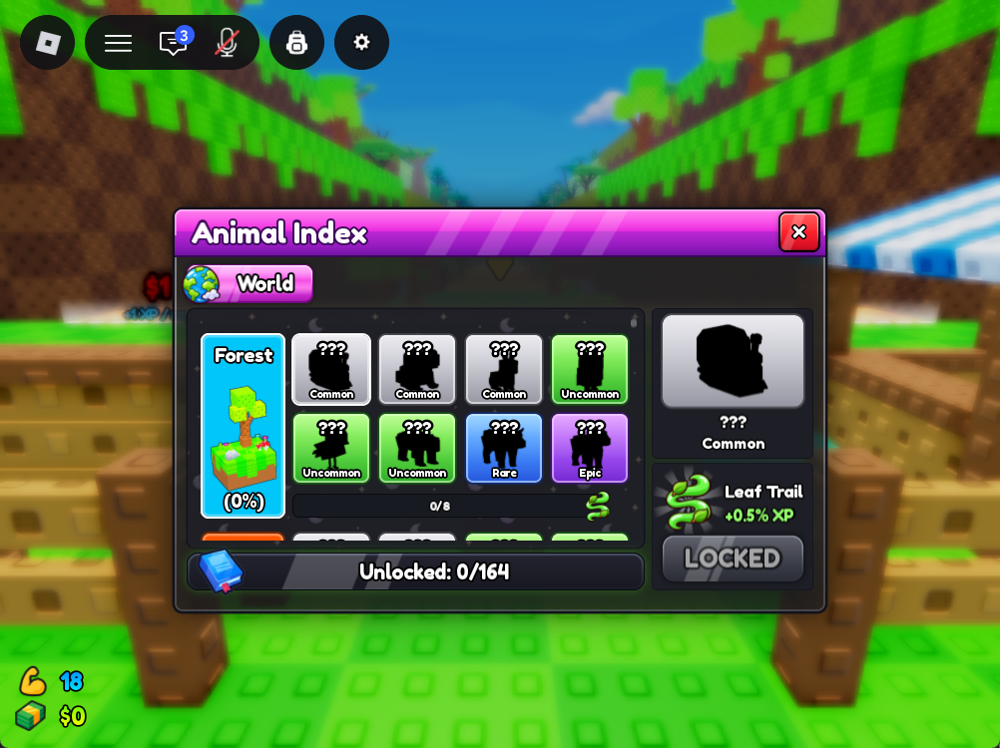
- **Settings** (opened from a game gear button added into Roblox's top bar): silver-gradient title, rows on darker rounded strips, blue slider fill with white knob and "100%", toggles as green pills with a white knob and "ON" label. 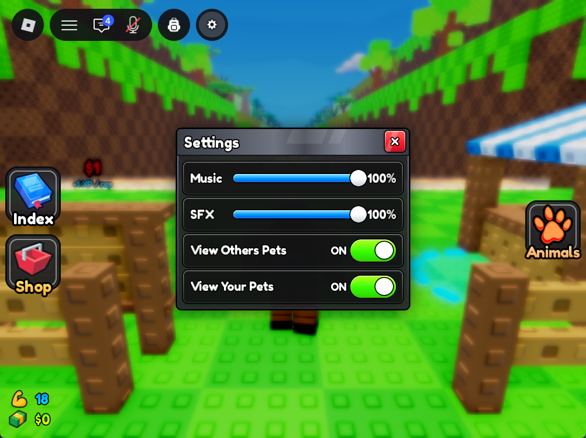

### Throw mode, reward and states

- Stepping on the line enters **throw mode: every menu tile and the cash stat disappear**; only Power stays. A vertical meter (capsule, 4 px black outline, 6 segments green→red, ~0.55 H tall) sits beside the character; "TAP TO THROW!" in huge stroked white and a "+0" counter. 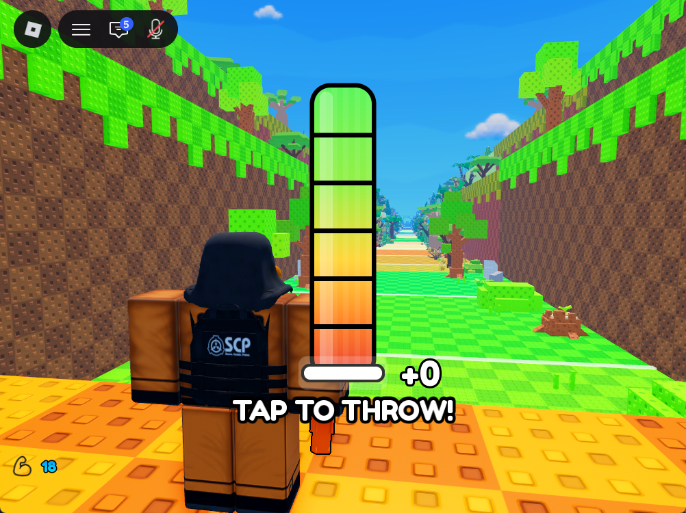
- During flight the screen **dims to ~30% brightness** and a "1.00X LUCK" readout sits top centre; the camera follows the food.
- **Reward (catch)**: a white flash fades out, a thin white **circle vignette** frames the animal, text stack at the bottom: mutation word "GOLD" (gold), name "BUNNY" (very large, ~0.08 H), "$5/s"; a **tilted "NEW!" sticker** (cream with orange text, rotated about -15°) beside the name. Then the HUD returns with "Place your animal" and floor arrows. 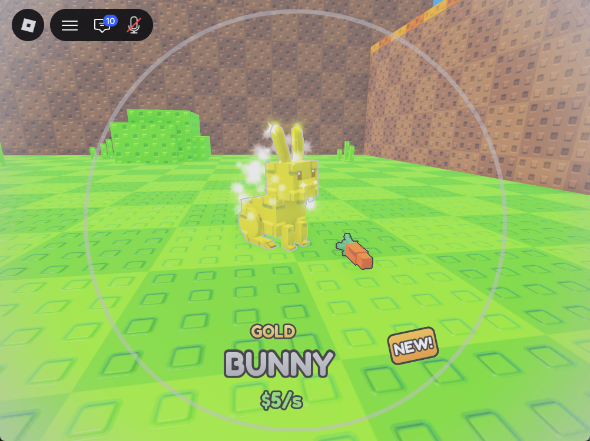
- Rarity: whole-card fill colour (Index), rarity word under the card, mutation word above the name.
- Locked: grey button with "LOCKED"; silhouettes for unknown entries.
- New: rainbow "New!" pill on shop cards, tilted "NEW!" sticker on the catch.
- Cannot afford: red price text in the world, nothing else seen.
- Notification dots: none on the game's own buttons during this session.
- Phone: the whole HUD is 3 big tiles on the edges plus 2 stats in a corner, everything else hides in throw mode. Tiles at 0.13 H are thumb-sized on a phone.

---

## 2. Steal An Egg

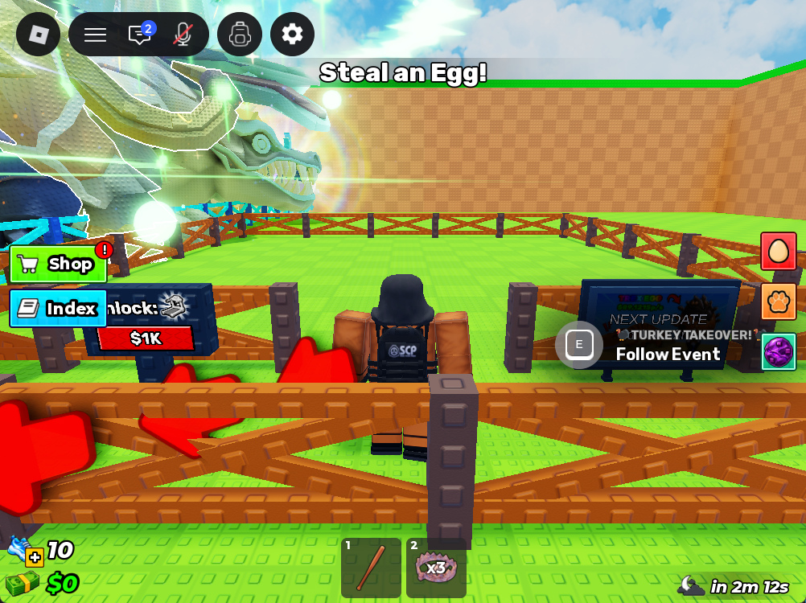

Same template family as Scare Your Favorite Streamer (study doc section 4), so this section lists only what differs or was newly seen.

### HUD layout

| Element | Where | Size | Treatment |
|---|---|---|---|
| **Shop**, **Index** pills | Left edge, x 12-133, y 305-405 | 121x46 px = **0.06 H** | Flat saturated pill (green, cyan), 2 px dark outline, small line icon inside on the left (not overhanging), white bold label with black stroke. Red **"!" notification dot** (22 px circle, white "!", white rim) on the Shop pill's top-right corner. The pill of the open panel darkens. |
| Right tiles | Right edge, x 946-990, y 290-460 | 46x46 = **0.06 H** squares | Icon only: red (egg), orange (paw), teal (event orb). 2 px dark outline. |
| Speed, Cash | Bottom-left | ~0.035 H | Shoe icon with a small yellow "+" badge (buy more), white italic "10"; cash stack + **green italic "$0"** with dark stroke. |
| Night timer | Bottom-right | ~0.03 H | Moon icon, white italic "in 2m 12s" on a dark gradient strip fading to the left. |
| Title banner | Top centre, y 90 | ~0.04 H | "Steal an Egg!" on a dark translucent band that fades out at both ends. |
| Hotbar | Bottom centre | 75x75 slots (0.1 H) | Grey translucent, item art, slot number top-left, stack count "x3". |
| World prices | Billboards | - | "$1K" white on a **red plate** (cannot afford). Proximity prompt: grey circle key cap "E", label "Follow Event". |

### Panels

- Shell: same as Scare Streamer (dark body with a faint stud-tile texture, coloured title bar with a stud pattern and diagonal streak, red square X with dark outline), centred, world blurred.
- **Shop** (green title): yellow section headers "-- FEATURED --", a limited egg card with a **countdown** "1d 19h 12m 11s" top-right, a rainbow "New!" pill, a tier label "DIVINE!" in rainbow italics on the rarest pet, odds % bottom-right of each pet tile, the old price struck through in red, four green Robux buttons each paired with a small magenta **gift** square on its left. **Section jump list outside the panel** on the right: 3D icons with labels (Featured tag, Stars, Speed shoe, Money) that scroll the panel to that section. 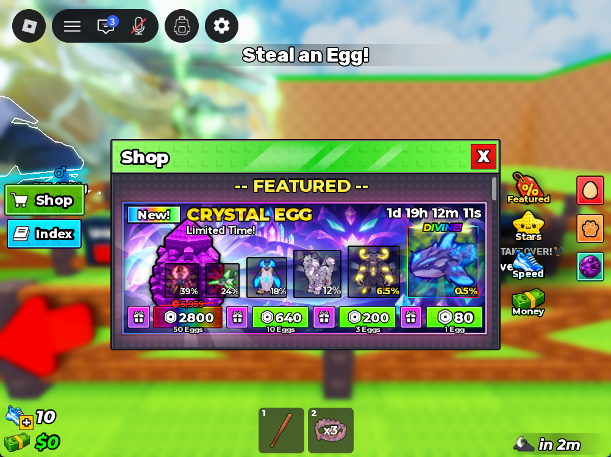 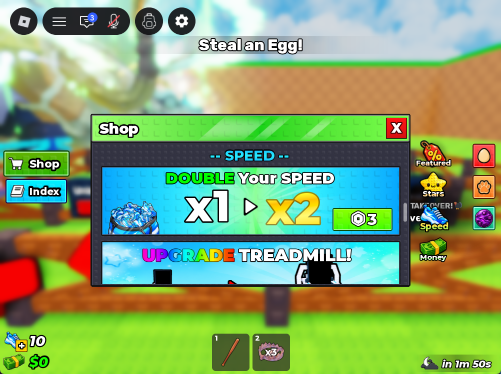
- **Pet Index** (cyan title): tabs "World" (blue, selected) and "Limited" (dull gold, not selected) **outside the panel on the right**; grid tiles filled with rarity colour (grey, green, blue, magenta, gold); a rewards box (cash + speed icons) with a grey disabled CLAIM! button. 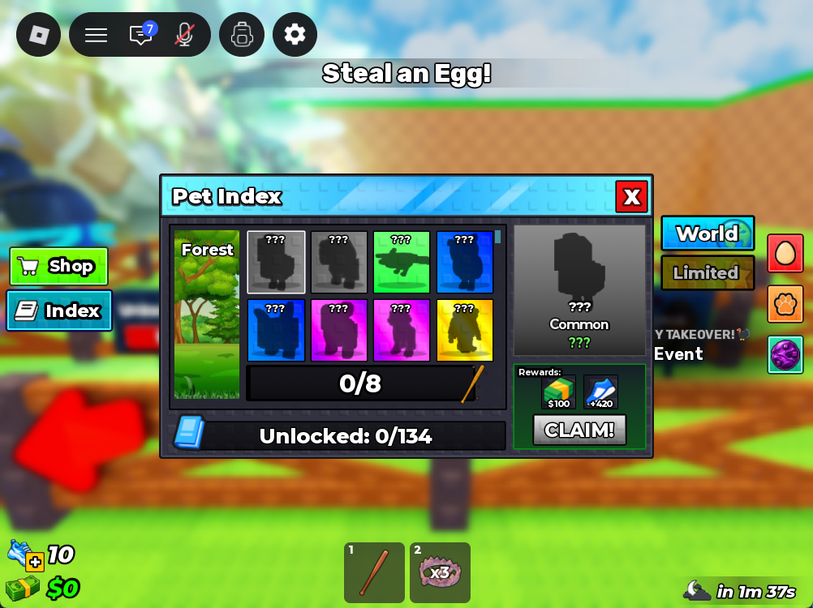
- **Side drawers** (egg and paw tiles): a panel docks to the right edge **in place of the tile column**, beige title strip ("Growing Eggs" with a small yellow "Grow All" button; "0/7 Active" with a red "+1 EQUIP [$1K]" chip), dark grid of empty slots, a red ">" tab on its left edge to collapse it, a small green "Equip Best" under it. 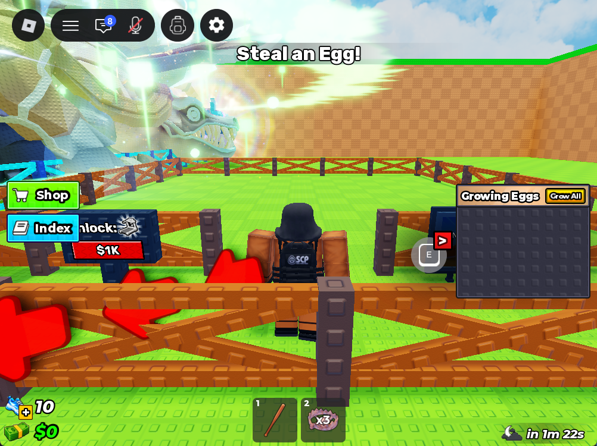
- **Event panel** (teal orb): a themed purple panel with **3D decoration overhanging the frame** (UFO, dishes), the event currency as a chip inside the title bar ("Void Pearls 0"), a big summary card "Fish Caught 0 / 1 Fish = 1 Point / Next reward in 5 more", then a horizontal track of milestone cards each with its reward and a grey **Locked** button; side tabs (Mastery, Dark Matter) outside the panel. 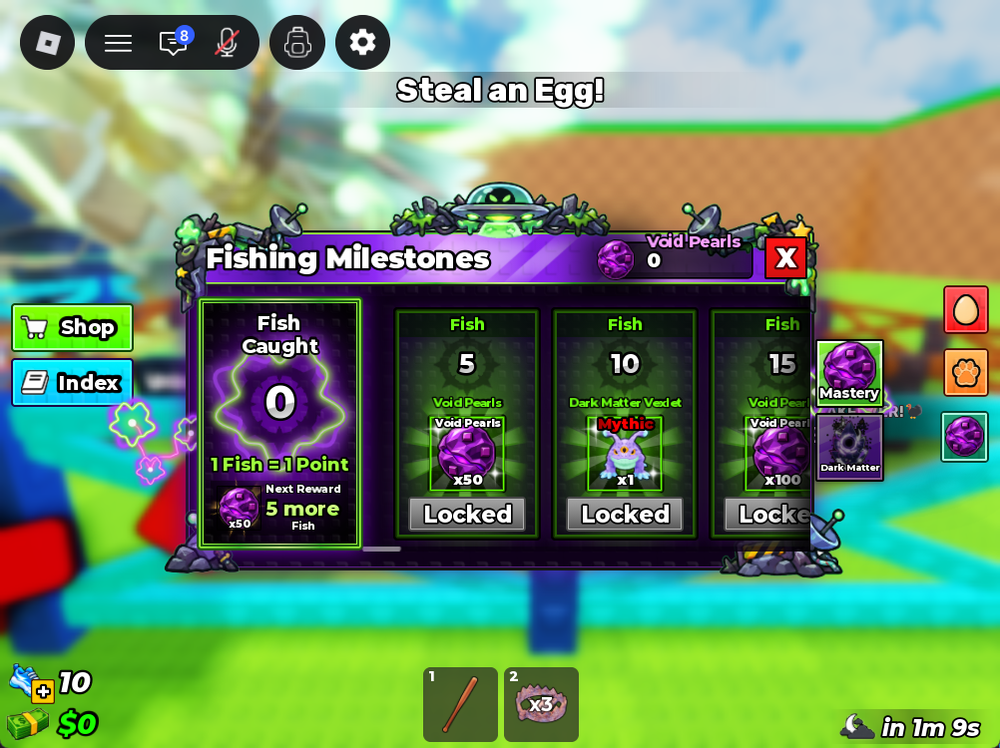
- **Settings**: silver title, yellow sliders, green toggles inside dark slots, scroll bar. 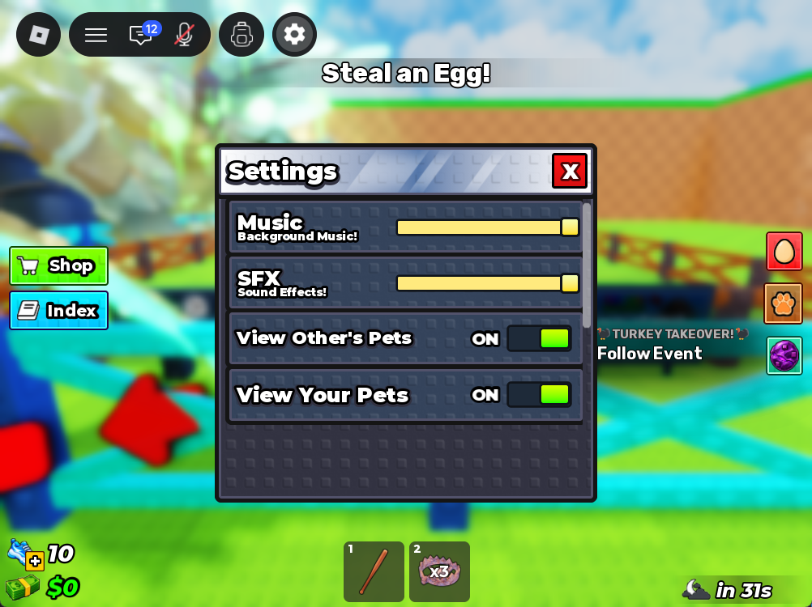

### States and moments

- **Cannot afford**: pressing the red "+1 EQUIP [$1K]" shows **"Not enough money"** in red with a dark stroke at bottom centre (y 0.83 H, just above the hotbar), no background, ~0.04 H, fades after ~2 s. Price chips are red before you press them. 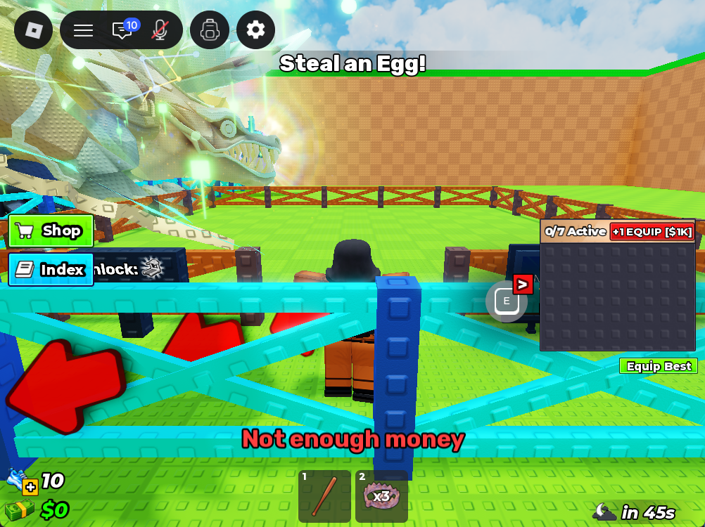
- **Announcement**: when the night timer hit 0, "ALL EGG RESET!" appeared directly under (and partly overlapping) the title banner. The overlap is a flaw to avoid: give toasts their own lane.
- Reward reveal: not reached in this session (needs a stolen egg); the same studio's reveal is the slot-machine roll in the Scare Streamer study.
- Phone: everything is on the edges, slim pills (0.06 H) leave the centre clear; drawers instead of modals for the things you check often (eggs growing, active pets).

---

## 3. Pet Simulator 99!

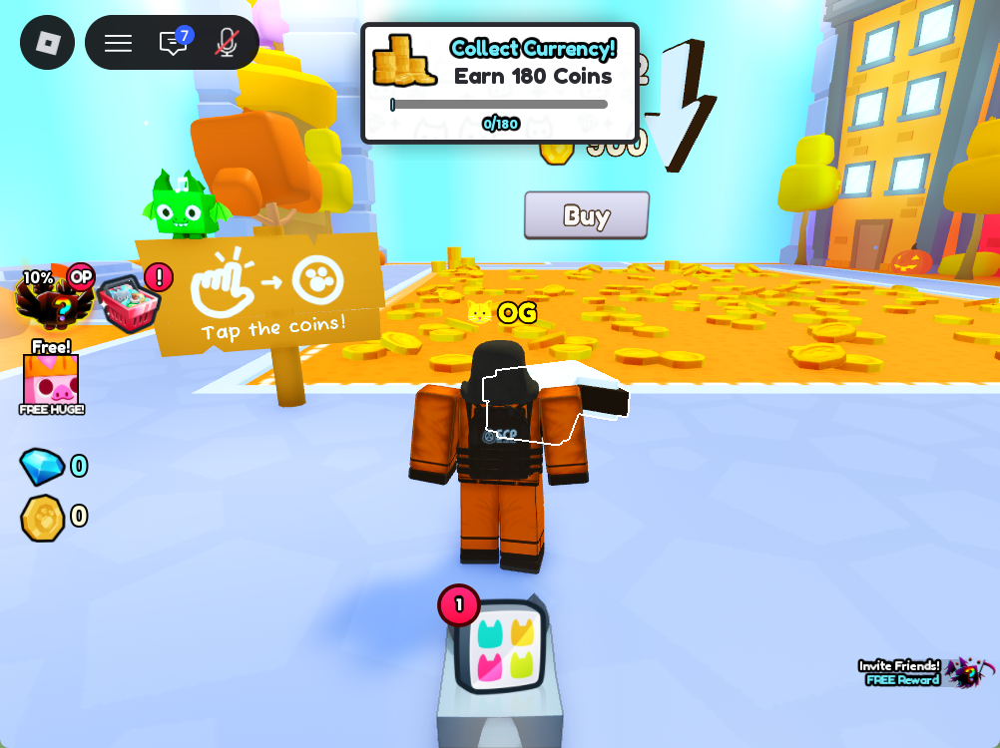

### HUD layout

| Element | Where | Size | Treatment |
|---|---|---|---|
| **Menu button** | Bottom centre | ~95x95 = **0.13 H** | A single 3D "tablet" icon on a light grey slot, red **count badge** (30 px circle, white number, white rim) top-left. Click: a **dock of five big 3D icons** slides up in a row (Pets, Shop, Achievements, Trading, Settings), ~90 px (0.12 H) each, **no backing tiles**; the open one gets a soft yellow sunburst glow behind it. |
| Currencies | Left edge, stacked, y 467 and 517 | icon ~45 px (0.06 H), number ~0.035 H | Diamond (cyan number), coin token (white number). **No pill backing**, numbers abbreviate as "3.26k" (lower-case k). |
| Promo shortcuts | Left edge above currencies | ~60 px icons | Event egg "10% OP" with red pill, shop basket with red "!" dot, "Free! FREE HUGE!" gift card. Icons with small stroked captions, no tiles. |
| **Quest card** | Top centre, x 362-640, y 24-145 | 280x120 = **0.16 H** | White card, 4 px dark outline, radius ~10; 3D icon on the left; title in **cyan with dark stroke** ("Collect Currency!"), goal in black bold ("Earn 180 Coins"); progress bar (cyan fill, grey track, 0.02 H tall) with "88/180" under it. When done it immediately swaps to the next quest ("Hatch New Pets! Unlock the Egg!"). |
| Bottom-right | | small | "Invite Friends! FREE Reward" stroked text with a character icon. |
| World | | | Area gate: coin price "900" on a billboard and a **Buy button that is grey while you can't afford it and turns green when you can**. Tutorial sign with pictogram (hand → paw) "Tap the coins!". A big **3D yellow arrow** with black outline on the ground points to the next goal. |

### Panels

- Shell: **white body with a faint tiled pattern** of the game's own pictograms, ~5 px dark outline (#2A2A35), radius ~18 px. **No title bar**: the title is big white stroked text sitting on the top edge, outside the body, with the menu's 3D icon overhanging the top-left corner. The **close button** is a 70 px (0.09 H) rounded square in hot pink-red with a white X and dark outline, **overhanging the top-right corner**. Big panels are 90% W x 62% H; Settings is smaller (58% W x 55% H). World behind is blurred. The dock stays visible under the panel so you can switch menus without closing. 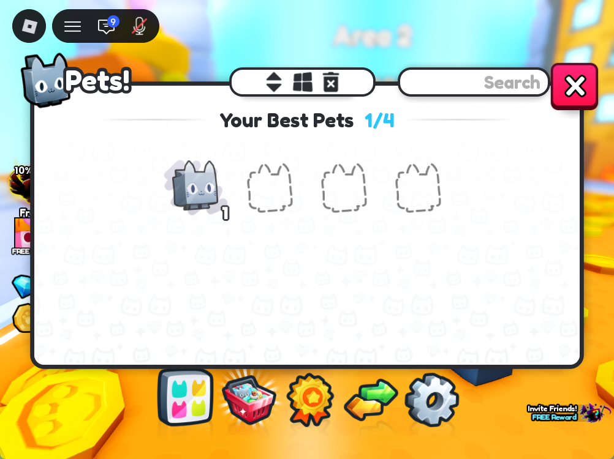
- **Pets**: toolbar pill on the top edge (sort, layout, delete icons), a separate white search pill; "Your Best Pets **1/4**" with the count in cyan; empty slots are **dashed outlines of a pet shape**; owned pet with its count "1" bottom-right.
- **Exclusive Shop**: full-width offer cards with warm gradients, items as 3D icons with **small gold tier pips** over each, quantity "x2" top-right, a big green Robux button (Robux glyph + number) bottom-right, a timer with an alarm-clock icon for limited packs, item chains joined by arrows. 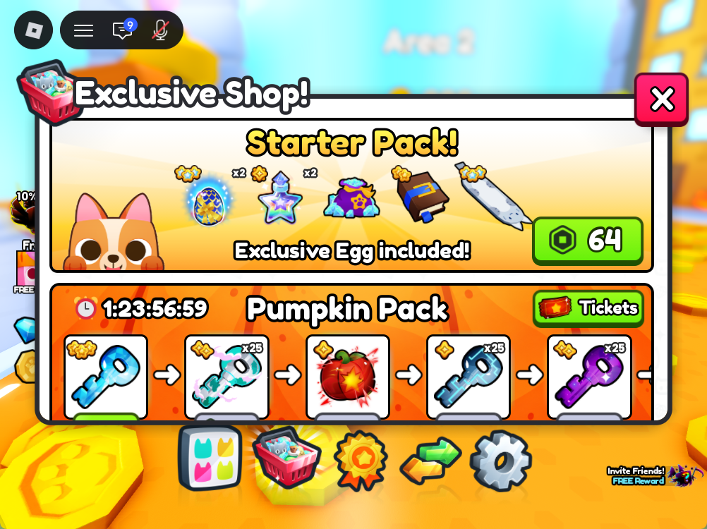
- **Achievements**: two-column cards with a pale cyan gradient, dark outline, star chip top-left, stroked title, goal text, progress bar "0/200", reward tiles as small **coloured squares** (blue, green) with the item icon and "x25" bottom-right. Header "Completed **0/106**". 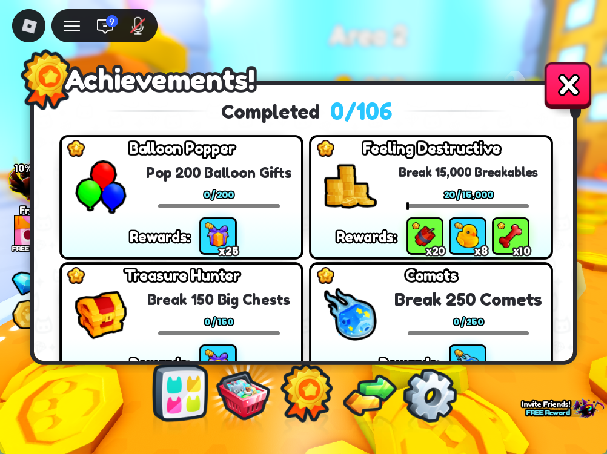
- **Settings**: blue section title "Controls", rows of dark text label on the left and a **green "Edit"** or **pink "Set"** button on the right (bevelled, white stroked text). 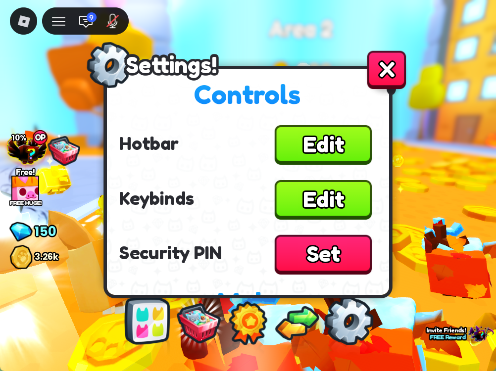
- **Pick your pet** (first-run): white card, four pet portraits, the chosen one marked by a **green circle with a white check** overlapping its corner, a big green "Ok!" button with a darker bottom bevel. 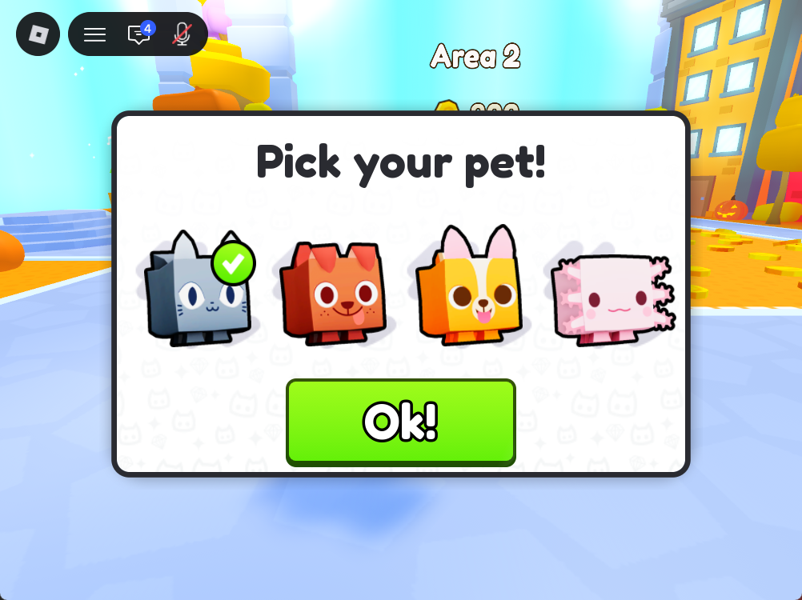

### States and moments

- **Reward**: coins burst out of the broken pile and **arc to the player**, white sparkle arcs sweep round the character, a coin billboard "3.7k" sits over the head, a green stroked toast "You have earned 100 diamonds!" appears above the hotbar position, and the left counters roll (the counter lags the head billboard: 628 vs 652). A "Free Pet Progress 20% 2/10" bar appeared at the very top. 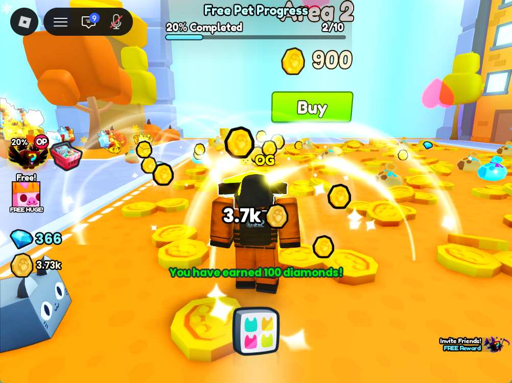 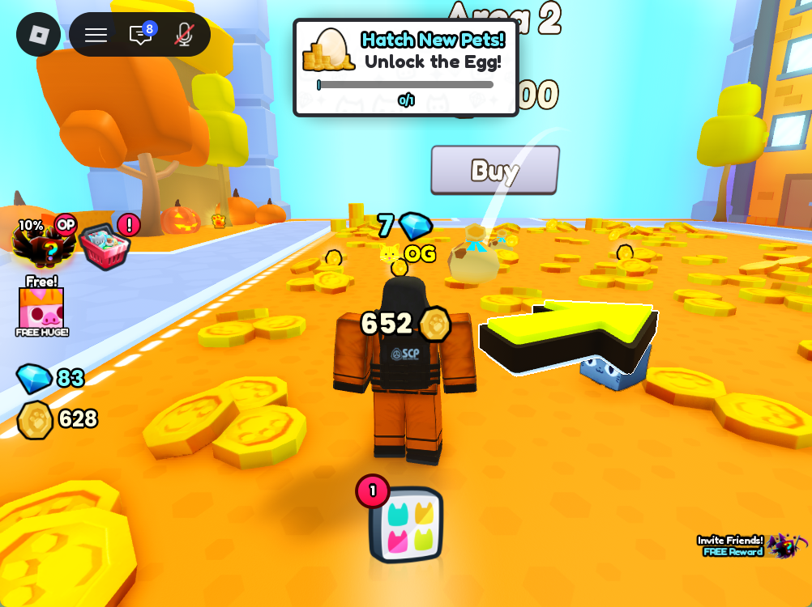
- **Cannot afford**: the area gate's Buy button was grey with 628 of 900 coins and green once the player had 3.7k: affordability by button colour, readable from a distance.
- Rarity: gold tier pips on items; reward tiles colour-coded by tier.
- New/attention: red count badge on the menu button, red "!" dot on the shop basket.
- Phone: one menu button at the bottom centre (thumb zone) instead of a column of buttons; currencies small on the left edge; the top centre is the quest card.

---

## 4. Adopt Me! (not reached)

The game opens on a "Welcome" card that requires agreeing to its Terms of Service before play. Accepting terms needs the user's own permission, so the session stopped there. What the gate shows: a white **torn-paper** card, a red logo, a green "Play!" button with a darker bottom bevel, an orange square news button with a red star badge. 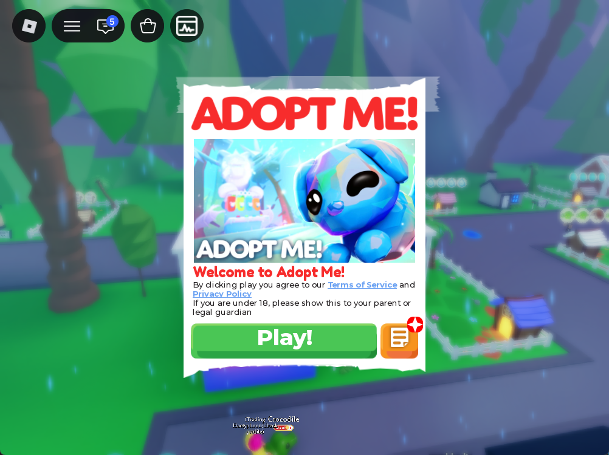

---

## 5. Comparison

| Point | Throw Food | Steal An Egg | Pet Sim 99 |
|---|---|---|---|
| Menu buttons | Big labelled tiles 0.13 H, left x2 + right x1 | Slim pills 0.06 H left, icon tiles 0.06 H right | One button bottom centre, opens a dock |
| Currencies | Bottom-left, no backing, coloured numbers | Bottom-left, no backing, italic green | Left edge, no backing, white numbers |
| Panel body | Dark | Dark with stud texture | White with pictogram pattern |
| Title | Gradient bar inside, colour per menu | Patterned bar inside, colour per menu | Text outside on the edge + overhanging 3D icon |
| Close | Red square in the bar | Red square in the bar | Pink-red square overhanging the corner |
| Rarity | Whole tile filled with rarity colour + word | Same | Tier pips / tile colour |
| Unaffordable | Red price | Red plate + "Not enough money" toast | Grey button until affordable |
| Objective | One line, top centre, no panel | Title band top centre | Quest card with progress bar, top centre |
| Mode HUD | Menus hide in throw mode | - | - |

## 6. Tool problems

1. **Screenshot grabbed Roblox Studio.** Another session had Studio in Play mode. Twice the screenshot showed Studio (`launch` before the player window was up, and once after a click), and that click (500,527) most likely landed in Studio's test client of Feed an Lay. `rbx.py` finds the right window (class `WINDOWSCLIENT`) but appears to capture and click by screen rectangle, so anything on top of the player gets the input. Workaround used: after every action, print the foreground window title and stop if it is not "Roblox" (it stayed "Roblox" for the rest of the session). Suggested fix: refuse to act if the foreground window after `SetForegroundWindow` is not the player.
2. `launch` while another game is open: closed the player first each time as advised; no problem.
3. Adopt Me's ToS gate stops automated play by design.
