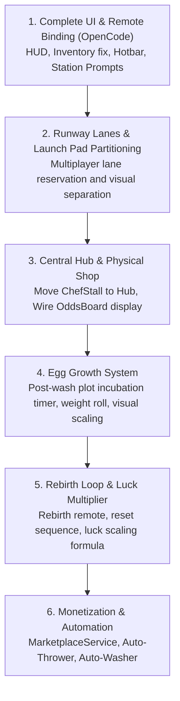

# Feed and Lay: V3 Implementation Status Audit

**Date:** 2026-11-20  
**Audit Scope:** Studio Place `Feed an Lay` (PlaceId `113603218122384`, read-only inspection) vs `docs/phase0_decisions.md` (Steps 1–4) and `Egg_Sanctuary_GDD.md`.  
**Note:** OpenCode is actively modifying the UI (`StarterPlayerScripts.UI.*` / `Loop.*`), lift/training system, and `SaveSchema.luau`. Those items are designated **IN PROGRESS**.

---

## 1. Feature Audit Matrix

| Feature / System | Source Spec | Status | Script & Line Reference | Size | Notes |
| :--- | :--- | :---: | :--- | :---: | :--- |
| **Hub with ChefStall & ODDS Board** | `phase0_decisions.md` (Step 1) | **PARTIAL** | `Workspace.PlotsV3.Plot_<n>.ViewingDeck.OddsBoard`; `src/server/V3/Main.server.luau:140` | **M** | `OddsBoard` part exists in plot viewing deck, and food is bought via `Buy` remote (`track = "Food"`). However, the centralized Hub model, physical ChefStall NPC/market stall, and global Odds board script are not implemented. |
| **Runway Lane Allocation & Holding** | `phase0_decisions.md` (Step 2) | **PARTIAL** | `src/server/V3/Main.server.luau:112-132` | **M** | Canyon launch pad bounding box (`LEDGE_C0`, `LEDGE_EXTENTS`) validates player position, but line 112 notes it is shared by all players. Dedicated runway lanes, lane reservation, and auto-throw lane holding do not exist. |
| **Dumbbell / Lift Training System** | `phase0_decisions.md` (Step 3) | **IN PROGRESS** | `src/server/V3/LiftRules.luau:1-115`; `src/server/V3/EggService.luau:240-278` | **S** | Server rhythm ring rules (`LiftRules.evaluateTap`) and remotes (`StartLift`, `Lift`, `StopLift`) exist. Marked **IN PROGRESS** because OpenCode is currently modifying the client lift loop and balance. |
| **Egg Growth (Replaces Instant Hatch)** | `phase0_decisions.md` (Step 4) | **MISSING** | `src/server/V3/EggRules.luau:494-520` | **L** | `EggRules.hatch` performs an immediate 3.5s reveal upon 100% cleanliness. No egg weight (kg) roll, growth timer, plot growth visual, or saved growth state exists in code. |
| **Food Tiers (T1–T8)** | `Egg_Sanctuary_GDD.md` (Section 3) | **DONE** | `src/shared/Economy.luau:10-19`; `src/server/V3/EggRules.luau:240-275` | **S** | All 8 food tiers (Red Apple to Cosmic Ambrosia) are defined with exact costs (0 to 1M), luck multipliers (1.0x to 100.0x), and shiny probabilities. Used by `EggRules.release`. |
| **5 Biomes & Distance Zones** | `Egg_Sanctuary_GDD.md` (Section 4) | **DONE** | `src/shared/Economy.luau:24-60, 151-160` | **S** | All 5 biomes (Dewdrop Meadow, Toxic Slime Marsh, Cinder Volcano, Sunken Coral Reef, Celestial Galaxy) defined with distance bounds (0 to 50k+ studs), base creature names, and income. Resolved in `EggRules.release:246`. |
| **Shiny & Creature Mutations** | `Egg_Sanctuary_GDD.md` (Section 3) | **DONE** | `src/shared/Economy.luau:63-68, 172-184`; `src/server/V3/EggRules.luau:257` | **S** | Normal (1.0x), Shiny (2.5x), Golden (5.0x), and Rainbow (10.0x) defined, rolled by `Economy.rollMutation`, and saved by `SaveSchema.luau:206`. |
| **Rebirth System** | `Egg_Sanctuary_GDD.md` (Section 3) | **PARTIAL** | `src/server/V3/SaveSchema.luau:38`; `src/shared/Economy.luau:233-241` | **M** | `rebirths` is tracked in save schema and `Economy.rebirthCost` is defined. However, there is no remote handler, no reset sequence, and rebirth bonus is not applied to throw luck. |
| **Gamepasses & Dev Products** | `Egg_Sanctuary_GDD.md` (Section 5) | **MISSING** | `src/server/V3/SaveSchema.luau:44` | **L** | Deferred per Phase 0 Decision 3 ("No gamepass code in Phases 1–3"). `receipts` table exists in save schema, but no MarketplaceService hooks, drones, robots, or developer products exist. |
| **Garden Incubators / Nest Slots** | `Egg_Sanctuary_GDD.md` (Section 5) | **DONE** | `src/shared/Economy.luau:80-87`; `src/server/V3/EggRules.luau:270` | **S** | Nest queue capacity starts at 3 and expands up to 8 slots via `Buy` remote (`track = "Nest"`). Enforced by `EggRules.luau:270` (`#data.nest >= data.nestSlots`). |
| **SaveSchema Persistence & Session Lock** | `phase0_decisions.md` (Decision 4) | **IN PROGRESS** | `src/server/V3/SaveStore.luau:1-179`; `src/server/V3/SaveSchema.luau:1-393` | **M** | Full v7 schema with lease locking (300s timeout, 60s autosave) and v5/v6 conversion. Marked **IN PROGRESS** as OpenCode is actively updating schema fields alongside UI changes. |
| **Client UI & Windows** | `docs/ui_style_spec.md` | **IN PROGRESS** | `StarterPlayerScripts.UI.*`; `StarterPlayerScripts.Loop.*` | **L** | Chunky Nest presets, HUD, Menus, Inventory, and Panels actively being built and debugged by OpenCode. |

---

## 2. Parity Between `src/` and Roblox Studio

Every exported file was compared character-for-character against the live place source using `StudioMCP.execute_luau` (`return <Instance>.Source`).

### Findings
* **`src/server/V3/*` (All 7 scripts):**
  * `SaveStore.luau`, `SaveSchema.luau`, `EggService.luau`, `EggRules.luau`, `LiftRules.luau`, `Onboarding.luau`: **100% byte-for-byte identical** to the place.
  * `Main.server.luau`: **Identical**, except lines 2–3 were updated in the repo copy to state that legacy scripts were moved to `legacy/` (per sync task item 3).
* **`src/shared/Economy.luau` & `Goals.luau`:**
  * **100% byte-for-byte identical** to the place.
* **`src/shared/SoundHelper.luau`:**
  * Shows as modified in git due **strictly to line endings**. The code and characters are 100% identical (1,279 characters); the original repository file had CRLF line endings, whereas the Studio export was written with standard LF.
* **`src/shared/GameConfig.luau`:**
  * Shows as modified in git due to:
    1. Line endings (CRLF $\rightarrow$ LF).
    2. **One comment difference on line 210:** The original repo had `-- Glowing lava cracks!` appended to `EggCoreMaterial = Enum.Material.Neon,`, whereas the Studio place copy omitted this comment. All logic, table entries, and numbers are 100% identical.

---

## 3. Proposed Build Order for a Playable Game

Smallest, lowest-risk steps first:

1. **Step 1: Finish UI & Interaction Wiring (Current OpenCode Scope — Small)**
   * Stabilize the HUD and station proximity triggers for `StartCharge`, `ReleaseThrow`, `StartLift`, and `StartWash`.
   * Ensure close buttons and panel transitions function without stuck windows.
2. **Step 2: Runway Lane Reservation & Multi-Throw Routing (Small)**
   * Partition the canyon launch ledge into 6 designated player runway lanes (`Lane_1` .. `Lane_6`) to prevent overlapping characters during simultaneous throws.
   * Add simple server reservation check when a player enters their plot's lane.
3. **Step 3: Hub & Centralized ChefStall / Odds Board (Medium)**
   * Place the ChefStall in the central plaza with an interaction prompt opening the food upgrade menu.
   * Wire the `ViewingDeck.OddsBoard` SurfaceGui to display live drop odds based on the player's equipped food tier.
4. **Step 4: Egg Growth Mechanic (Phase 0 Decision 2 — Medium/Large)**
   * Transition from instant reveal to plot ground incubation: washed eggs occupy an egg growth spot on the plot floor.
   * Add server timer per rarity (Common fast $\rightarrow$ Mythic slow) and random weight roll (kg).
   * Update `SaveSchema.luau` to persist incubating eggs (`growthStart`, `duration`, `targetWeight`).
5. **Step 5: Rebirth Progression Loop (Medium)**
   * Implement `Rebirth` RemoteFunction in `EggService.luau`.
   * Add reset logic: wipe coins and strength, retain pets/unlocked index, increment `data.rebirths`.
   * Incorporate `(1 + rebirths * RebirthBonus)` into `Economy.rollRarity` and `rollMutation`.
6. **Step 6: Monetization & Gamepass Services (Large)**
   * Implement `MarketplaceService.ProcessReceipt` and gamepass ownership checks.
   * Wire Gamepass perks: Lucky Chef Pass (2x food luck), +4 Incubators (expand nest slots to 8), Auto-Washer robot, and Auto-Thrower drone.

---

## 4. Adopted Balancing Decisions (User Approved 2026-11-20)

The recommended balance parameters have been formally approved by the user and codified into `src/shared/Economy.luau` and `src/shared/GameConfig.luau`:

### A. Balance & Pacing
1. **Egg Growth Incubation Durations:**
   * *Common:* 30 seconds
   * *Uncommon:* 60 seconds (1 minute)
   * *Rare:* 120 seconds (2 minutes)
   * *Epic:* 300 seconds (5 minutes)
   * *Legendary:* 900 seconds (15 minutes)
   * *Mythic:* 1800 seconds (30 minutes)
   * *Secret:* 3600 seconds (60 minutes)
   * *Code Reference:* `Economy.EggGrowthTimes` & `GameConfig.EggGrowthTimes`.
2. **Pet Weight & Income Multipliers:**
   * Egg weight (kg) rolls randomly across rarity bounds (e.g. Common: 0.8–1.6 kg, Mythic: 50.0–120.0 kg).
   * Weight scales the hatched pet model visually (`petVisualScale`, 0.75x to 1.6x).
   * Weight awards a subtle bonus to passive coin yield (`weightIncomeMultiplier`, 1.0x to 1.35x), rewarding heavyweight eggs without destabilizing passive income.
   * *Code Reference:* `Economy.rollEggWeight`, `Economy.petVisualScale`, `Economy.weightIncomeMultiplier`.
3. **Strength Progression Scaling:**
   * Dumbbell training gains scale with equipped dumbbell tier (`Economy.Dumbbells` Tier 1: +10/rep, progressing upward) rather than a flat fixed rate, maintaining steady progression toward deeper biomes.

### B. Rarity, Luck & Monetization Targets
1. **Mythic Odds Ceilings & Diminishing Returns:**
   * Slot C in Starfield/Galaxy biomes maintains a controlled ~7.1% ceiling with T8 food, preventing hyper-inflation.
   * Discovery pity meter is active in `Economy.DISCOVERY_PITY` (guaranteeing missing discoveries on dry streaks).
2. **Approved Gamepass Pricing:**
   * Auto-Thrower Drone: R$ 799
   * Auto-Washer Robot: R$ 899
   * Lucky Chef Pass (2x food luck): R$ 499
   * +4 Incubators (Max Nest 8): R$ 399
   * Golden Feast Bait: R$ 99
   * Instant Hatch Potion: R$ 49
